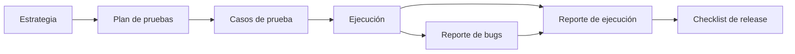

# QA Templates Repository


Repositorio personal de plantillas para documentación de QA (Quality Assurance). El objetivo es tener un "kit de inicio" estandarizado para copiar, pegar y adaptar rápidamente en cualquier proyecto.

## Estructura del repositorio

```text
qa-templates/
├── docs/
│   ├── estrategia-de-pruebas.md
│   ├── plan-pruebas-completo.md
│   ├── plan-pruebas-corto.md
│   ├── guia-de-uso.md
│   ├── glosario.md
│   └── checklist-release.md
├── tests/
│   ├── casos-prueba.md
│   ├── datos-ejemplo.md
│   ├── sesion-exploratoria.md
│   └── matriz-trazabilidad.md
├── reportes/
│   ├── reporte-ejecucion.md
│   └── reporte-bugs.md
├── ejemplos/
│   └── ejemplo-login/
├── .github/ISSUE_TEMPLATE/bug_report.md
└── LICENSE
```

### `docs/` — Planeación y guías

- `estrategia-de-pruebas.md`: enfoque general de calidad (pirámide de pruebas, niveles vs. tipos, CI/CD, Definition of Done).
- `plan-pruebas-completo.md`: plantilla robusta para proyectos medianos/grandes.
- `plan-pruebas-corto.md`: plantilla de 1 página para proyectos pequeños.
- `guia-de-uso.md`: convenciones de nombres, estados y cómo usar estas plantillas.
- `glosario.md`: vocabulario de tipos y niveles de prueba.
- `checklist-release.md`: lista go/no-go previa a liberar.

### `tests/` — Casos y datos de prueba

- `casos-prueba.md`: plantilla para redactar casos de prueba (formato ficha y formato tabla).
- `datos-ejemplo.md`: estructura sugerida para documentar los datos de prueba.
- `sesion-exploratoria.md`: charter y notas de una sesión de pruebas exploratorias.
- `matriz-trazabilidad.md`: relación requisito → casos → bugs.

### `reportes/` — Documentos generados durante la ejecución

- `reporte-ejecucion.md`: resultados de un ciclo de pruebas.
- `reporte-bugs.md`: plantilla estándar para reportar defectos.

### `ejemplos/`

Plantillas ya llenadas con un proyecto demo (`ejemplo-login`) para ver cómo se usan en la práctica. Esta carpeta tiene su propio [`README.md`](ejemplos/ejemplo-login/README.md) que indica qué plantilla original corresponde a cada archivo (`plan-login.md`, `casos-login.md`, `bug-lgn-001.md` y `reporte-ejecucion-login.md`).

## Flujo de trabajo sugerido



## ¿Qué plantilla uso y cuándo?

| Necesito... | Uso |
|---|---|
| Definir el enfoque general de calidad | `docs/estrategia-de-pruebas.md` |
| Planear un módulo grande o mediano | `docs/plan-pruebas-completo.md` |
| Planear algo pequeño | `docs/plan-pruebas-corto.md` |
| Documentar casos de prueba | `tests/casos-prueba.md` |
| Documentar datos y usuarios de prueba | `tests/datos-ejemplo.md` |
| Probar de forma exploratoria | `tests/sesion-exploratoria.md` |
| Demostrar cobertura de requisitos | `tests/matriz-trazabilidad.md` |
| Reportar un defecto | `reportes/reporte-bugs.md` |
| Reportar resultados de un ciclo | `reportes/reporte-ejecucion.md` |
| Decidir si se libera una versión | `docs/checklist-release.md` |

## ¿Cómo usar estas plantillas?

1. Identifica el documento que necesitas en la carpeta correspondiente.
2. Copia el contenido del archivo `.md`.
3. Pégalo en el repositorio de tu proyecto real.
4. Renombra el archivo (ej. de `plan-pruebas-completo.md` a `plan-pruebas-pagos-terminal-x.md`) y completa la información.
5. Sigue las convenciones de `docs/guia-de-uso.md` (IDs, estados, severidad).

## Convenciones generales

- **Idioma:** estructura en español, terminología técnica de pruebas en inglés (ej. *smoke*, *E2E*, *regression*).
- **Formato:** Markdown (`.md`) para fácil versionado con Git.
- **Nombres de archivo:** todo en minúsculas y separado por guiones (`kebab-case`).
- **IDs:** `TC-[MOD]-[NNN]` para casos y `BUG-[MOD]-[NNN]` para defectos (ver la guía de uso).

## Autor

Yair Uriel García González

## Licencia

Este proyecto se distribuye bajo la licencia MIT. Consulta el archivo `LICENSE`.
