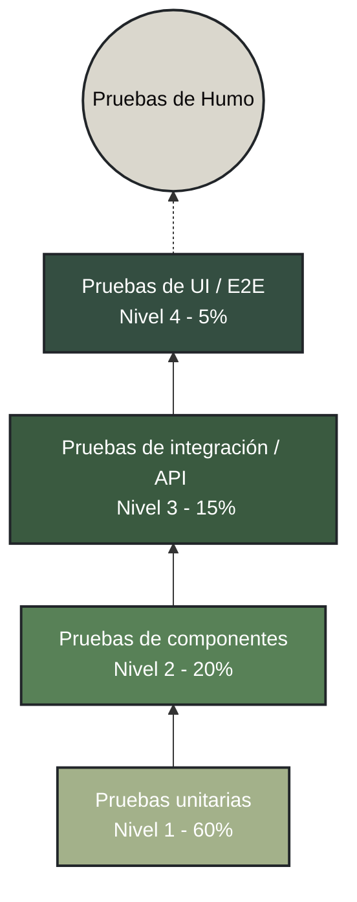
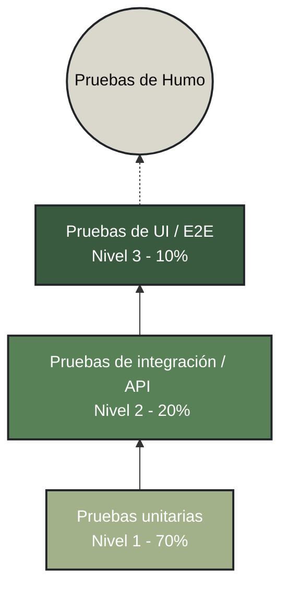

# Estrategia de Pruebas — [Nombre del Proyecto]

| | |
|---|---|
| **Versión** | 1.0 |
| **Fecha** | 10/11/2026 |
| **Autor** | Yair Uriel García González |

---

## 1. Objetivo

Definir el enfoque, los niveles y las herramientas de prueba que se utilizarán para contribuir a la calidad del software, equilibrando la velocidad de entrega con la mitigación de riesgos.

## 2. Alcance

Esta estrategia aplica tanto a pruebas manuales como automatizadas, y cubre los distintos niveles de prueba definidos en la pirámide.

## 3. La Pirámide de Pruebas (Test Pyramid)

Esta estrategia se basa en la Pirámide de Pruebas. Según el volumen y el tiempo del proyecto, se puede optar por:

- **Modelo de 4 niveles:** evolución del modelo original que incorpora pruebas de componentes.
- **Modelo de 3 niveles:** el modelo original de Mike Cohn.

En ambos casos, la mayor parte de la inversión debe estar en la base (pruebas rápidas y baratas) y una menor proporción en la cima (pruebas lentas y costosas).  
Las *pruebas de humo* no forman parte de la pirámide: son un tipo de prueba transversal que se ejecuta como un **filtro** rápido antes de profundizar en cualquier nivel.

### 3.1 Pirámide de 4 niveles

### 3.2 Pirámide de 3 niveles

> Los porcentajes son una referencia sobre la distribución del esfuerzo, no una regla estricta.

### 3.3 Descripción de los niveles

#### Pruebas Unitarias - Unit Tests (Base)

- **Qué prueban:** funciones, métodos y clases de forma aislada.
- **Herramientas:** Jest, Pytest, JUnit, NUnit.
- **Regla:** deben ejecutarse en milisegundos. Ningún cambio se sube a un Pull Request (PR) sin sus pruebas unitarias correspondientes.

#### Pruebas de Componentes - Component Tests (solo modelo de 4 niveles)

- **Qué prueban:** un módulo o componente completo de forma aislada, con sus dependencias externas simuladas (mocks/stubs).
- **Herramientas:** Testing Library, Storybook, Vitest, TestContainers.
- **Regla:** validan el comportamiento del componente como unidad funcional, sin depender de otros servicios reales.

#### Pruebas de Integración y API - API / Integration Tests (Medio)

- **Qué prueban:** la comunicación entre módulos, bases de datos y endpoints (REST/GraphQL).
- **Herramientas:** Postman/Newman, Supertest, RestAssured, Pact (pruebas de contrato).
- **Regla:** validan que el backend y sus conexiones funcionen correctamente sin depender de la interfaz gráfica.

#### Pruebas E2E / UI - UI / E2E Tests (Cima)

- **Qué prueban:** flujos completos desde la perspectiva del usuario (happy paths y flujos de negocio críticos). Pueden cubrir pruebas de sistema o de aceptación.
- **Herramientas:** Cypress, Playwright, Selenium.
- **Regla:** solo se automatiza lo estrictamente necesario. Si la interfaz cambia mucho, estas pruebas se vuelven frágiles y caras de mantener.

#### Pruebas de Humo - Smoke Tests (transversales)

- **Qué prueban:** que el sistema esté "vivo" y que los flujos más básicos funcionen.
- **Herramientas:** Cypress (flujos básicos), Postman (validar que los endpoints principales respondan 200 OK).
- **Regla:** son la primera línea de defensa tras un deploy. Si fallan, se hace rollback inmediato.

## 4. Niveles vs. Tipos de Prueba

La pirámide no es el único marco de clasificación. Conviene distinguir tres conceptos que a veces se mezclan:

- **Niveles de prueba (ISTQB / modelo en V):** clasifican por **etapa o alcance**: unitarias/componente, integración, sistema y aceptación.
- **Pirámide de pruebas:** clasifica por **costo, velocidad y cantidad**: unitarias, integración/API y UI/E2E.
- **Tipos de prueba:** responden a **qué característica se prueba**: funcionales, rendimiento, seguridad, usabilidad, regresión, contrato, etc. Cualquier nivel puede tener varios tipos.

Aclaraciones frecuentes:

- **E2E no es un nivel ISTQB.** Es una forma de ejecutar pruebas de sistema (o de aceptación) recorriendo todo el flujo, normalmente por la UI.
- **Funcionales no es un nivel, es un tipo de prueba.** Cualquier nivel puede incluir pruebas funcionales.
- La lista "Unitarias, Integración, Funcionales, Aceptación" es muy común, pero mezcla "funcionales" (tipo) con "sistema" (nivel).

### 4.1 Tabla de equivalencia

| Pirámide | Nivel ISTQB | Tipos de prueba comunes |
|---|---|---|
| Unit Tests | Unitaria / Componente | Funcional |
| Component Tests | Componente / Integración | Funcional |
| Integration / API Tests | Integración | Funcional, contrato, seguridad |
| UI / E2E Tests | Sistema (y a veces Aceptación) | Funcional, regresión, usabilidad |
| *(fuera de la pirámide)* UAT | Aceptación | Funcional, validación de negocio |
| *(transversal)* Smoke | Sistema | Validación post-despliegue |
| *(transversal)* Performance, Seguridad | Sistema | No funcionales |

Las definiciones completas están en [`glosario.md`](glosario.md).

## 5. Pruebas Manuales vs. Automatizadas

| Tipo de prueba | Enfoque | ¿Se automatiza? |
|---|---|---|
| Exploratorias | Descubrir bugs no previstos y problemas de usabilidad. | ❌ No. Requiere intuición humana. |
| Aceptación (UAT) | Validar que el negocio esté conforme. | ❌ Rara vez. |
| Regresión | Asegurar que lo que funcionaba no se rompió. | ✅ Siempre (base y medio de la pirámide). |
| Smoke | Validar que el sistema está vivo tras un despliegue. | ✅ Sí, en cada pipeline. |
| Performance | Medir carga, estrés y estabilidad. | ✅ Siempre (k6, JMeter, Locust). |
| Seguridad | Encontrar vulnerabilidades. | ⚠️ Parcial (SAST/DAST en CI/CD, pentesting manual). |

## 6. Estrategia de Automatización y CI/CD

| Momento | Qué se ejecuta |
|---|---|
| Cada Pull Request | Pruebas unitarias y análisis estático (linters). |
| Merge a `develop` | Pruebas de integración y API. |
| Merge a `main` o pre-release | Suite E2E completa y performance básico. |
| Post-despliegue (QA o Prod) | Pruebas de humo automatizadas. |
| Nightly build | Suite completa, incluida regresión visual. |

## 7. Gestión de Entornos y Datos

- **Entornos:** Local (desarrollo), Staging/QA (pruebas) y Producción.
- **Datos:** ninguna prueba automatizada debe depender de datos de producción. Se usan fixtures o una base de datos de pruebas (seeding) antes de cada ejecución.
- **Aislamiento:** las pruebas de integración y E2E deben limpiar los datos que crean para no ensuciar el entorno de QA.

## 8. Criterios de Calidad (Definition of Done)

Un desarrollo se considera terminado solo si:

- [ ] El código tiene pruebas unitarias y pasan localmente.
- [ ] El pipeline de CI/CD está en verde (sin errores de build ni de linters).
- [ ] Las pruebas de API asociadas a la funcionalidad pasan.
- [ ] No rompió ninguna prueba de regresión existente.
- [ ] Si aplica, el flujo principal (E2E) está cubierto.
- [ ] Si es una funcionalidad de alto riesgo, se realizó una sesión de pruebas exploratorias.
- [ ] La documentación de casos de prueba manuales está actualizada.

## 9. Herramientas del Stack de Calidad

| Propósito | Herramientas sugeridas |
|---|---|
| Gestión de casos y bugs | Jira, Azure DevOps, GitHub Issues |
| Pruebas unitarias | Jest, Pytest, JUnit, xUnit |
| Pruebas de componentes | Testing Library, Storybook, Vitest |
| Pruebas de API | Postman, Insomnia, RestAssured |
| Pruebas E2E / UI | Cypress, Playwright, Selenium |
| Pruebas de performance | k6, JMeter, Locust |
| CI/CD | GitHub Actions, GitLab CI, Jenkins |
| Reportes de cobertura | SonarQube, Codecov |

## 10. Documentos relacionados

- [Plan de pruebas completo](plan-pruebas-completo.md) y [plan corto](plan-pruebas-corto.md)
- [Guía de uso y convenciones](guia-de-uso.md)
- [Checklist de release](checklist-release.md)
