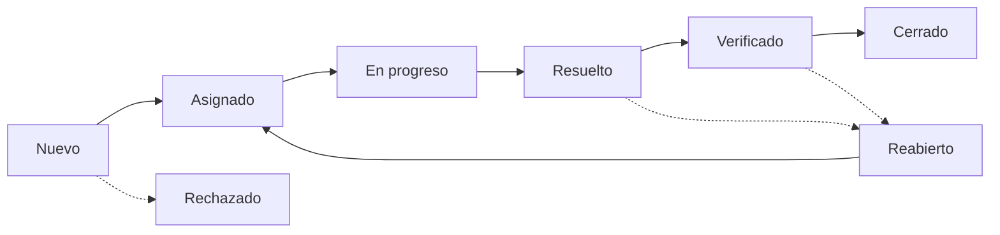

# Guía de Uso y Convenciones

Este documento define la recomendación para llenar las plantillas de este repositorio y mantener la consistencia entre cada proyecto.

## 1. Códigos de módulo

Todos los IDs usan un **código de módulo de 3 letras**. Define la tabla al inicio del proyecto y úsala siempre igual.

| Código | Módulo |
|---|---|
| LGN | Login / Autenticación |
| PAG | Pagos |
| CAR | Carrito de compras |
| USR | Usuarios (API) |
| ART | Artículos / Catálogo |

## 2. Nomenclatura de Casos de Prueba

Todo caso de prueba debe llevar un ID único con el formato:

`TC-[MOD]-[NNN]`

**Ejemplos:**

- `TC-LGN-001` (primer caso del módulo Login)
- `TC-PAG-015` (caso 15 del módulo Pagos)
- `TC-USR-003` (caso 3 de la API de Usuarios)

Si el caso es a nivel de API, indícalo en el campo "Nivel" de la plantilla en lugar de alargar el ID.

## 3. Nomenclatura de Defectos (Bugs)

`BUG-[MOD]-[NNN]`

**Ejemplos:**

- `BUG-LGN-001` (primer defecto del módulo Login)
- `BUG-PAG-005` (defecto 5 de Pagos)

Si usas Jira o GitHub Issues, agrega el número del ticket en el campo "Ticket" del reporte para mantener la trazabilidad (ej. `#42`).

## 4. Estados de un Caso de Prueba

Durante la ejecución, usa únicamente estos estados:

- **Passed:** el resultado obtenido coincide con el esperado.
- **Failed:** el resultado obtenido es distinto al esperado (se debe crear un `BUG-[MOD]-[NNN]`).
- **Blocked:** no se puede ejecutar por un fallo de entorno, una dependencia no lista o un bug crítico previo.
- **Skipped:** el caso se omitió (ej. la funcionalidad se desestimó para este release).
- **Draft:** el caso está en redacción y aún no está listo para ejecutarse.

## 5. Ciclo de vida de un Defecto

| Estado | Significado |
|---|---|
| **Nuevo** | Recién reportado, pendiente de revisión. |
| **Asignado** | Tiene responsable de corregirlo. |
| **En progreso** | El desarrollador está trabajando en la corrección. |
| **Resuelto** | La corrección está lista y desplegada en el entorno de pruebas. |
| **Verificado** | QA confirmó que la corrección funciona. |
| **Cerrado** | Verificado y sin acciones pendientes. |
| **Reabierto** | La corrección no funcionó o el defecto reapareció. |
| **Rechazado** | No es un defecto (comportamiento esperado, duplicado o no reproducible). |

## 6. Prioridad vs. Severidad

Es común confundirlos, por eso usa estas reglas:

- **Severidad:** impacto técnico del fallo (Crítica, Alta, Media, Baja).
  - *Ej: la app se cierra al hacer clic (Crítica).*
  - *Ej: el sistema no muestra los artículos al realizar una consulta (Alta).*
- **Prioridad:** urgencia para el negocio (Alta, Media, Baja).
  - *Ej: el logo corporativo está desalineado (Severidad Baja, pero Prioridad Alta porque lo vio el CEO).*
  - *Ej: los colores de la interfaz no son los del diseño (Severidad Baja, Prioridad Media).*

## 7. Datos de Prueba

- **Uso de PII:** queda estrictamente prohibido usar datos personales reales (nombres, correos, teléfonos, direcciones) de clientes en entornos de prueba.
- **Realismo de negocio:** para validar reglas de negocio complejas (jerarquías, catálogos, artículos) usa un *snapshot* de producción **anonimizado** o, en su defecto, datos sintéticos que repliquen la estructura y los casos borde de producción.
- **Gestión:** documenta los usuarios de prueba en `tests/datos-ejemplo.md`. Las contraseñas reales o sensibles van en el gestor de secretos del equipo, no en el repositorio.
- **Archivos:** si usas un set de datos (JSON, CSV, SQL), guárdalo en una carpeta `fixtures/` de tu proyecto.

## 8. Tipos y niveles de prueba

Para mantener el vocabulario alineado:

- Consulta `docs/glosario.md` para las definiciones.
- Consulta la sección 4 de `docs/estrategia-de-pruebas.md` para la diferencia entre **niveles** y **tipos** de prueba.
- Usa siempre los nombres técnicos en inglés (Unit, Integration, Smoke, E2E, etc.) para facilitar la búsqueda.

## 9. Versionado de los documentos

- Cada documento lleva **versión** y **fecha** en el encabezado.
- Los cambios relevantes se registran en la tabla "Historial de cambios" del plan de pruebas.
- Usa versión mayor (2.0) para cambios de alcance o estrategia y menor (1.1) para correcciones.
